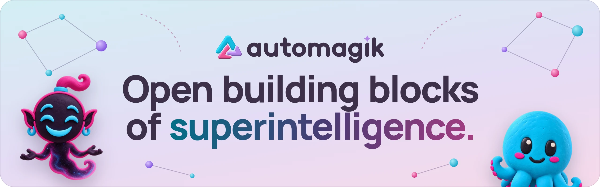
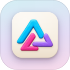
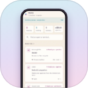
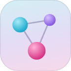
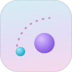

  <picture>
    <source media="(prefers-color-scheme: dark)" srcset="./art/banner-dark.webp">
    <source media="(prefers-color-scheme: light)" srcset="./art/banner-light.webp">
    
  </picture>

# Automagik

**Open building blocks of superintelligence.**

Use one, or bring them together. Each block puts your own agents to work, on your own machines.

| Block | What it does |
|---|---|
| <picture><source media="(prefers-color-scheme: dark)" srcset="./art/block-desktop-dark.png"></picture> [**Automagik Desktop**](https://github.com/automagik-si/automagik) | Your agent team, in your chats. Talk to it, hand work over, review what comes back. Mac and Linux. |
| <picture><source media="(prefers-color-scheme: dark)" srcset="./art/block-mobile-dark.png"></picture> [**Automagik Mobile**](https://github.com/automagik-si/automagik/tree/dev/apps/pocket) | Your coding agents on your Android phone, paired to your own machines. |
| <picture><source media="(prefers-color-scheme: dark)" srcset="./art/block-genie-dark.png"></picture> [**Genie**](https://github.com/automagik-si/genie) | Turn a wish into a branch, a test run and a report you approve. |
| <picture><source media="(prefers-color-scheme: dark)" srcset="./art/block-omni-dark.png"></picture> [**Omni**](https://github.com/automagik-si/omni) | Connect WhatsApp, Telegram, Slack and Discord to your agents. |
| <picture><source media="(prefers-color-scheme: dark)" srcset="./art/block-arca-dark.png"></picture> [**Arca**](https://github.com/automagik-si/arca) | Be your own cloud. Infrastructure for AI agents. |
| <picture><source media="(prefers-color-scheme: dark)" srcset="./art/block-cloud-dark.png"></picture> **Cloud** | One sign-in, organisations and hosted workspaces. Coming soon. |
| <picture><source media="(prefers-color-scheme: dark)" srcset="./art/block-mykes-dark.png"></picture> **Mykes** | Coming soon. |

Free and open source under Apache-2.0. Docs: [docs.automagik.dev](https://docs.automagik.dev)

---

Part of [we unfold](https://weunfold.ai) · Open Intelligence
